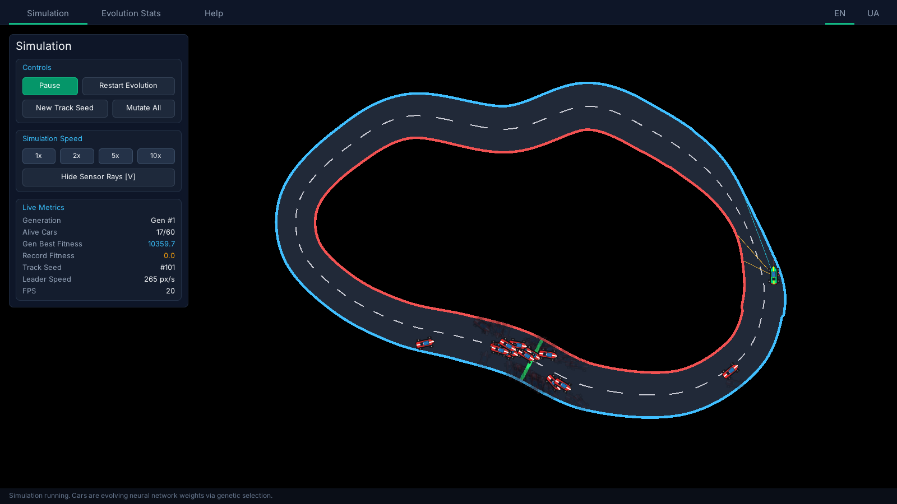
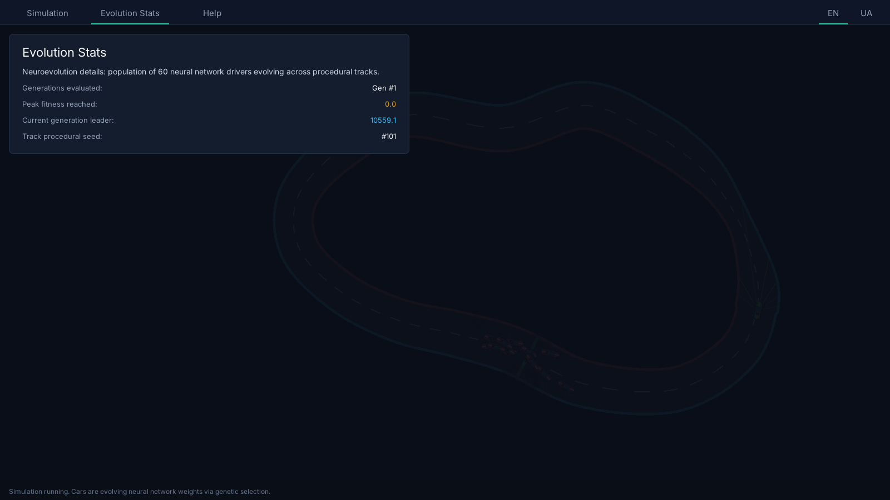
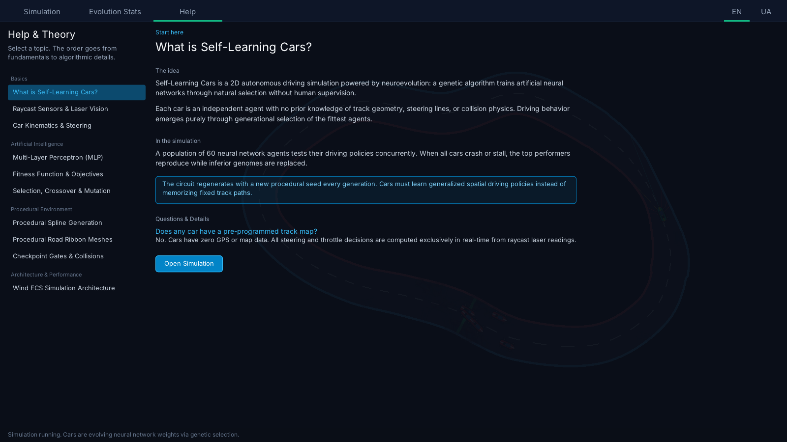
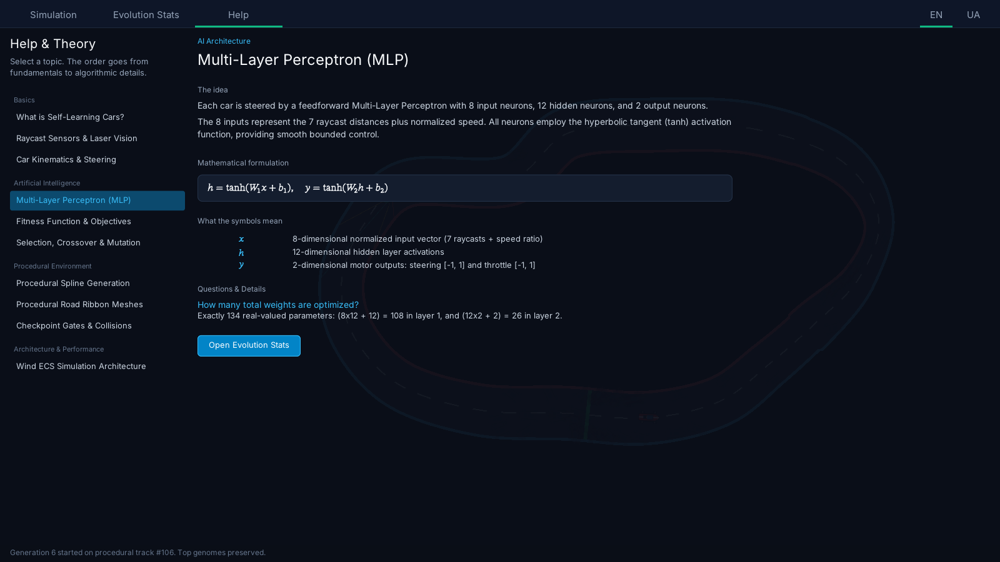
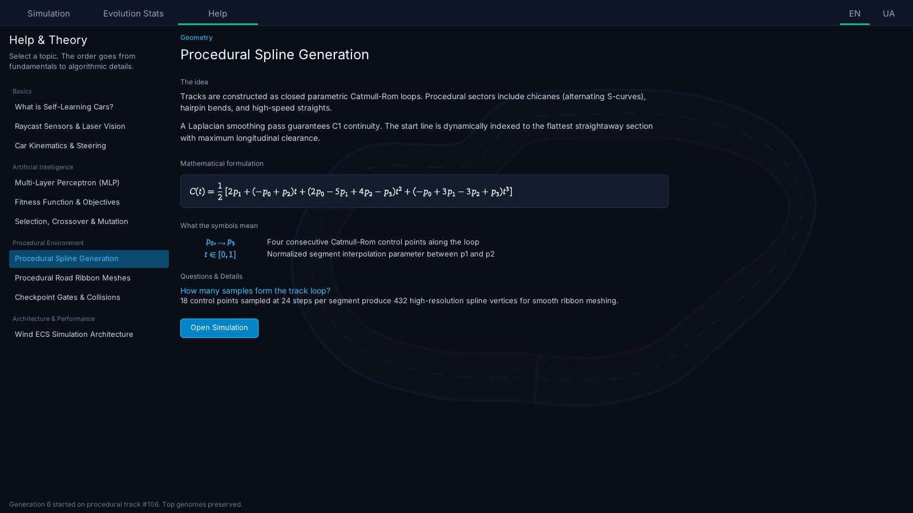
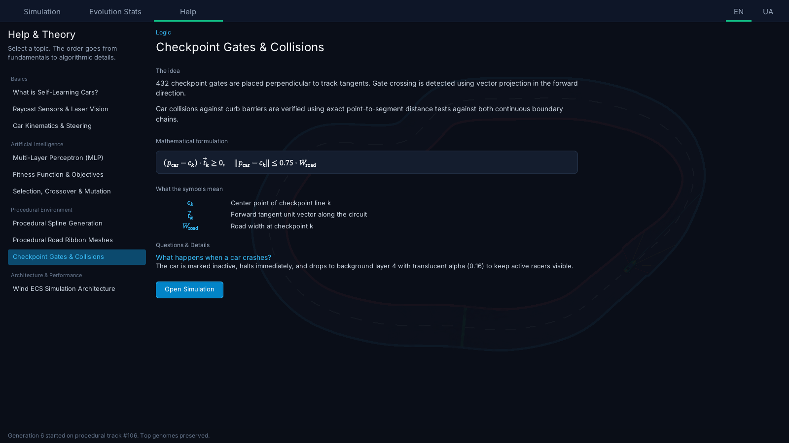
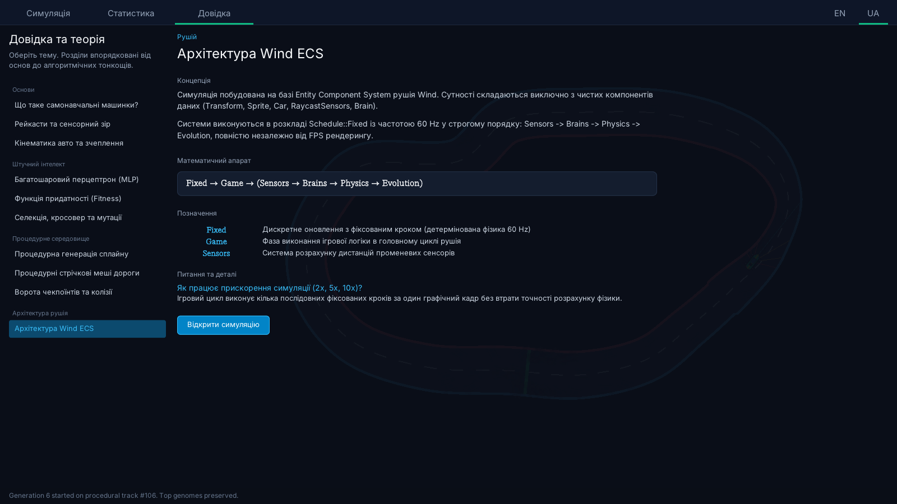

# Self-Learning Cars — 2D Neuroevolution Simulation

An interactive 2D autonomous vehicle simulation written in C++23 on top of the [Wind engine](https://github.com/wismh/wind-engine). Cars are steered by feedforward neural networks (Multi-Layer Perceptrons) that evolve across generations using a genetic algorithm (selection, uniform crossover, Gaussian mutation, elitism).

To ensure that the population learns **generalized spatial awareness and dynamic driving policies** rather than simply memorizing the sequence of turns on a static track (overfitting), **the racetrack is procedurally generated with a unique topology, chicanes, and hairpin turns on every single generation**.

The program is also an interactive exploration tool. You can adjust the simulation speed in real time (up to 10x), toggle the visibility of sensory laser raycasts, monitor fitness progression, force new track seeds, or mutate all genomes on the fly. A built-in reference guide explains the mathematical models behind neural activation, vehicle kinematics, genetic selection, and procedural ribbon meshes. The interface and theory guide are fully localized in English and Ukrainian; preferences are remembered across sessions.



## Features

- **Simulation.** Full control over simulation state (Play/Pause, Restart Evolution, Force New Track Seed, Mutate All). Real-time HUD displaying alive agents, current generation, record and leader fitness, current vehicle speed, and frame rate.
- **Simulation Speed.** Fast-forward multipliers (**1x**, **2x**, **5x**, **10x**) allowing generations to be evaluated in seconds without compromising fixed-timestep 60 Hz physics accuracy.
- **Neural Network Brain.** Each car is steered by a fast feedforward Multi-Layer Perceptron (8 inputs, 12 hidden neurons with $\tanh$ activation, 2 motor outputs).
- **Sensory Laser Vision.** 7 raycast distance sensors cast across a $120^\circ$ forward arc plus vehicle speed telemetry, visualizable in real time on the generation leader.
- **Genetic Algorithm.** Natural selection over a population of 60 concurrent agents with elitism (preserving top performers), tournament selection, uniform crossover, and Gaussian mutation.
- **Procedural Ribbon Tracks.** Closed-loop Catmull-Rom splines with variable width, hairpin turns, chicane sectors, and curbs generated on the CPU as smooth ribbon meshes uploaded directly to GPU vertex buffers.
- **Evolution Stats.** Dedicated dashboard displaying peak fitness records, generation turnover history, and training metrics.
- **Help & Theory.** A comprehensive 10-topic interactive reference covering neural networks, genetic algorithms, kinematics, procedural geometry, and the Wind ECS architecture with math formulas and diagrams.
- **Two Languages.** Complete user interface and theory guide localized in English and Ukrainian; choice is saved to user data.

## Screenshots

### Simulation Screen


### Evolution Stats



### Theory & Reference Guide



### Interactive Theory Topics

| Neural Network Architecture | Procedural Spline Generation |
| :---: | :---: |
|  |  |

| Checkpoint Gates & Collisions | Ukrainian Localization |
| :---: | :---: |
|  |  |

## How it works

### 1. Neural Network Architecture

Each car is driven by an individual Multi-Layer Perceptron with 8 input features, 12 hidden units, and 2 continuous outputs:

- **Inputs (8):** 7 raycast laser distances normalized to $[0, 1]$ spanning $[-60^\circ, -40^\circ, -20^\circ, 0^\circ, 20^\circ, 40^\circ, 60^\circ]$ relative to the car heading, plus normalized forward velocity.
- **Hidden Layer (12):** fully connected layer with hyperbolic tangent ($\tanh$) activations.
- **Outputs (2):** continuous steering torque in $[-1, 1]$ and throttle/braking in $[-1, 1]$.

```math
\mathbf{h} = \tanh(\mathbf{W}_1 \mathbf{x} + \mathbf{b}_1), \quad \mathbf{y} = \tanh(\mathbf{W}_2 \mathbf{h} + \mathbf{b}_2)
```

Each genome consists of exactly 134 real-valued floating-point weights $(8 \times 12 + 12 = 108$ in layer 1, and $12 \times 2 + 2 = 26$ in layer 2).

### 2. Kinematics & Handling

Vehicles use a simplified 2D bicycle kinematic model:
- Steering directly influences angular orientation $\theta$ based on current forward speed.
- Lateral velocity is dampened every fixed step by a lateral drag factor, simulating tire grip and preventing perpetual sliding.
- Cars detect collisions with track curb boundaries using point-to-segment distance testing against the continuous barrier lines.

### 3. Fitness & Genetic Algorithm

The fitness function evaluates navigation performance and speed while penalizing crashes:

```math
F = N_{\text{cp}} \cdot 100 + \left(1 - \frac{d_{\text{next}}}{W_{\text{road}}}\right) \cdot 50 + d_{\text{total}} \cdot 0.04
```

- $N_{\text{cp}}$: total consecutive checkpoint gates crossed along the track.
- $d_{\text{next}}$: Euclidean distance to the center of the next checkpoint gate.
- $W_{\text{road}}$: local road width at the target gate.
- $d_{\text{total}}$: cumulative distance traveled along the circuit.

**Anti-Stall Watchdog:** A car that fails to reach the next checkpoint within 4.5 seconds or spins backwards is retired immediately.

When all 60 cars crash or stall:
1. **Elitism:** The top 10% highest-fitness genomes are passed directly into the next generation without modification.
2. **Selection:** Parent pairs are chosen using tournament selection (size 4).
3. **Crossover:** Offspring genomes are produced via uniform crossover with equal gene inheritance probabilities.
4. **Gaussian Mutation:** Genes are perturbed by a zero-mean normal distribution:

```math
w_i' = w_i + \mathcal{N}(0, \sigma^2), \quad \sigma = 0.15
```

### 4. Procedural Track & Ribbon Meshes

Tracks are generated procedurally as closed Catmull-Rom loops:
1. Control points are distributed radially with randomized distances and perturbation offsets to introduce hairpin bends, high-speed straights, and chicanes.
2. Laplacian smoothing is applied across 3 iterations to guarantee $C^1$ continuity and eliminate sharp corners.
3. Left and right road boundaries are extruded along perpendicular normal vectors $\vec{n}(i)$:

```math
\mathbf{v}_L(i) = \mathbf{p}(i) + \vec{n}(i) \cdot w_L(i), \quad \mathbf{v}_R(i) = \mathbf{p}(i) - \vec{n}(i) \cdot w_R(i)
```

Curvature-adaptive offsets prevent self-intersecting swallowtail singularities on sharp inside corners. The asphalt road surface, curbs, and dashed centerline markings are converted into GPU vertex buffers using `IGraphicFactory::create_mesh`.

## Build, run and export

The project is built, run and exported with the Wind Editor, which is part of the [wind-engine](https://github.com/wismh/wind-engine) repository. Get the editor from there and then:

1. Open the Wind Editor and open this folder as a project (it contains `wind_project.toml`).
2. Press **Play**. The editor builds the game module and starts the simulation.
3. To make a standalone build, use the editor's **Export**.

The project targets the engine version written in `wind_project.toml`. Use the matching Wind SDK.

## Saved files

User preferences are stored in the per-user data directory of the game (organization `wismh`, application `self-learning-cars`). Nothing is written into the project folder.

- `locale.txt`: saves the selected interface language (`en` or `uk`).

## Project layout

```
self-learning-cars/
├── assets/
│   ├── css/
│   │   ├── cars.css            # Styling for HUD, cards, tabs, and buttons
│   │   └── cars.css.meta
│   ├── locale/
│   │   ├── en.strings          # English string table
│   │   ├── uk.strings          # Ukrainian string table
│   │   └── *.meta
│   ├── textures/
│   │   ├── car.png             # Standard race car sprite
│   │   ├── leader_car.png      # High-visibility leader sprite
│   │   ├── pixel.png           # 1x1 primitive for road quads and rays
│   │   └── app_icon.png        # Application window icon
│   └── ui/
│       ├── cars.xml            # Declarative MVVM HUD layout
│       ├── cars.xml.meta
│       └── help_topics/        # 10 interactive theory & reference documents
│           ├── intro.xml (+.meta)
│           ├── sensors.xml (+.meta)
│           ├── kinematics.xml (+.meta)
│           ├── neural_network.xml (+.meta)
│           ├── fitness.xml (+.meta)
│           ├── genetics.xml (+.meta)
│           ├── spline_generation.xml (+.meta)
│           ├── road_mesh.xml (+.meta)
│           ├── checkpoints.xml (+.meta)
│           └── ecs.xml (+.meta)
├── src/
│   ├── ai/
│   │   ├── neural_network.h    # Fast MLP with 8 inputs, 12 hidden, 2 outputs
│   │   ├── genetic_algorithm.h # Population, crossover, mutation, elitism
│   │   └── genetic_algorithm.cpp
│   ├── track/
│   │   ├── track_generator.h   # Procedural spline, wall segments, checkpoints
│   │   └── track_generator.cpp
│   ├── ecs/
│   │   ├── components.h        # Car, RaycastSensors, Brain, Config, Stats
│   │   ├── spawner.h / .cpp    # Spawns camera, road ribbon meshes, cars, sensor rays
│   │   ├── car_sensors_system.*# Raycast line-intersection and crash detection
│   │   ├── car_brain_system.*  # Neural forward pass mapping sensors to controls
│   │   ├── car_physics_system.*# Vehicle kinematics, friction, checkpoints
│   │   ├── ray_render_system.* # Visualizes leader's raycasts in real time
│   │   ├── evolution_system.*  # Generation turnover, GA steps, track re-seeding
│   │   └── simulation_systems.*# Registers ECS fixed and frame systems
│   ├── help/
│   │   ├── help_topic_table.h  # Section and topic catalog definition
│   │   ├── help_view_model.h   # NavItem and Topic ViewModel
│   │   └── help.h / help.cpp   # Coordinates navigation and topic activations
│   ├── panels/
│   │   ├── simulation_panel.h  # HUD command bindings and stat synchronizer
│   │   └── simulation_panel.cpp
│   ├── view/
│   │   ├── car_view_model.h    # MVVM view model binding cars.xml
│   │   └── car_view_model.cpp
│   ├── loc/
│   │   ├── tr.h                # Localization helper
│   │   ├── locale_prefs.h      # User preference loader/saver
│   │   └── locale_prefs.cpp
│   ├── game.h / game.cpp       # Main GameBase implementation
│   └── main.cpp                # ENGINE_GAME entry point
└── tests/
    ├── test_neural_network.cpp # Unit tests for forward pass and bounds
    ├── test_genetic_algorithm.cpp # Unit tests for population & elitism
    ├── test_track_generator.cpp   # Unit tests for closed loop procedural tracks
    └── test_help.cpp              # Unit tests for help topic catalog integrity
```

## Tests

The project includes unit tests using GoogleTest (provided by the Wind SDK) covering the neural network forward pass, genetic algorithm reproduction and elitism, procedural track spline closure, and help catalog mapping. To build and run them:

```powershell
cmake -B build-tests -G "Ninja Multi-Config" -DCMAKE_PREFIX_PATH="<path-to-wind-sdk>" -DCARS_TESTS=ON -DCMAKE_CONFIGURATION_TYPES="DebugGame;Release"
cmake --build build-tests --config Release
ctest --test-dir build-tests -C Release --output-on-failure
```
